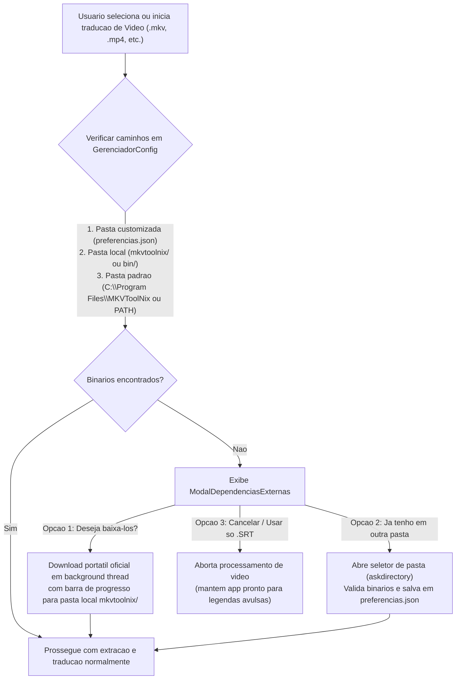

# Planejamento: Releases 100% MIT e Gerenciamento Sob Demanda de Dependencias GPLv2

Este documento detalha o plano arquitetural e de implementacao para desacoplar completamente binarios licenciados sob **GPLv2/GPLv3** (`mkvmerge.exe`, `mkvextract.exe` e `ffmpeg.exe`) dos executaveis `.exe` distribuidos nas GitHub Releases, garantindo conformidade estrita com a licenca **MIT** do projeto e oferecendo uma experiencia guiada ao usuario.

---

## 1. Diagnostico Atual e Motivacao Juridica/Tecnica

1. **Situacao Atual no Empacotamento ([build.py](../packaging/build.py)):**
   - O script `packaging/build.py` verifica se `mkvmerge.exe` e `mkvextract.exe` existem na maquina de build e os injeta dentro do `.exe` via `--add-binary` (no modo `--onefile`) ou copia a pasta `mkvtoolnix/` para `dist/` (no modo `--onedir`).
   - Como o **MKVToolNix** e licenciado sob **GPLv2**, distribuir seus binarios embutidos dentro de um executavel unico (`--onefile`) gera atrito de conformidade entre MIT e GPLv2 (exigencia de oferta de codigo-fonte correspondente da mesma versao binaria embutida e debate sobre *combined work* vs. *mere aggregation*), alem de adicionar ~35 MB extras ao `.exe`.
2. **Estado Desejado:**
   - Os arquivos `TradutorLegendas.exe` e `TradutorLegendas_Classico.exe` publicados no GitHub conterao **exclusivamente o codigo do projeto (MIT)** e bibliotecas Python compativeis, sem nenhum executavel GPLv2 embutido.
   - Caso o usuario processe apenas legendas avulsas (`.srt`, `.ass`, `.txt`), nenhuma dependencia externa e exigida.
   - Caso o usuario adicione ou inicie a traducao de um arquivo de video (`.mkv`, `.mp4`, `.webm`, `.avi`, `.wmv`) e os binarios nao sejam encontrados nem na pasta local do programa nem na pasta padrao do Windows, o sistema exibira uma **janela modal de escolha**:
     1. **Baixar automaticamente** as ferramentas para a pasta local do programa (`mkvtoolnix/`); ou
     2. **Indicar outra pasta** do computador onde o usuario ja possua os programas instalados.

---

## 2. Diagrama do Fluxo de Resolucao e Escolha do Usuario

---

## 3. Decisoes Arquiteturais Definidas

1. **Momento de Exibicao da Janela de Escolha:**
   - O modal sera acionado de forma contextual quando o usuario **adicionar um arquivo de video na fila ou clicar em Iniciar Traducao** com um video na fila e os binarios nao forem encontrados. Quem abrir o aplicativo apenas para traduzir legendas `.srt`/`.ass`/`.txt` avulsas nao sera interrompido por alertas desnecessarios.
2. **Metodo de Download Automatico ("Deseja baixa-los?"):**
   - Download direto da distribuicao portatil oficial para a pasta local `mkvtoolnix/` ao lado do `.exe`, com barra de progresso em tempo real e sem exigir permissao de Administrador do Windows, mantendo `winget` como contingencia secundaria.

---

## 4. Planejamento Detalhado das 7 Etapas de Implementacao

### Etapa 1: Desacoplamento Total no Build e CI/CD (`100% MIT`)
- **Arquivos alvo:**
  - [`packaging/build.py`](../packaging/build.py)
  - [`.github/workflows/release.yml`](../.github/workflows/release.yml)
- **Acoes:**
  1. Remover de `compilar_alvo` em `packaging/build.py` a injecao `--add-binary` de `mkvmerge.exe` e `mkvextract.exe`.
  2. Remover a copia automatica da pasta `mkvtoolnix/` no pos-build de `packaging/build.py`.
  3. Remover de [`GerenciadorConfig`](../tradutor/config.py) a busca por `mkvtoolnix` dentro de `DIRETORIO_RECURSOS` (`sys._MEIPASS`), pois o executavel congelado nao carregara mais binarios embutidos.

---

### Etapa 2: Evolucao da Resolucao de Caminhos e Preferencias Persistentes
- **Arquivos alvo:**
  - [`tradutor/config_usuario.py`](../tradutor/config_usuario.py)
  - [`tradutor/config.py`](../tradutor/config.py)
  - [`tradutor/manipulador_mkv.py`](../tradutor/manipulador_mkv.py)
- **Acoes:**
  1. Manter a chave `"mkvtoolnix_custom": ""` em `PreferenciasUsuario.PADRAO` e adicionar `"ffmpeg_custom": ""` para casos em que o `ffmpeg.exe` esteja em pasta separada.
  2. Padronizar em `GerenciadorConfig` a ordem de busca para **MKVToolNix** (`mkvmerge.exe` e `mkvextract.exe`):
     - **Prioridade 1 (Pasta customizada do usuario):** Caminho salvo em `PreferenciasUsuario.obter("mkvtoolnix_custom")`.
     - **Prioridade 2 (Pasta local portatil):** `<DIRETORIO_EXECUCAO>/mkvtoolnix/` e `<DIRETORIO_EXECUCAO>/bin/`.
     - **Prioridade 3 (Pastas padrao do sistema e PATH):** `C:\Program Files\MKVToolNix`, `C:\Program Files (x86)\MKVToolNix` e `shutil.which("mkvmerge")`.
  3. Padronizar em `GerenciadorConfig.get_ffmpeg_path()` a mesma hierarquia (`ffmpeg_custom` -> `bin/` ou `mkvtoolnix/` local -> `C:\Program Files\ffmpeg\bin` -> `shutil.which("ffmpeg")`), substituindo a busca isolada em `ManipuladorMkv._localizar_ffmpeg`.
  4. Criar metodo `GerenciadorConfig.validar_pasta_mkvtoolnix(caminho: str) -> bool` que verifica se a pasta informada (ou sua subpasta `bin/`) contem `mkvmerge.exe` e `mkvextract.exe`.

---

### Etapa 3: Servico de Download e Configuracao de Dependencias (`tradutor/instalador_dependencias.py`)
- **Arquivo novo:** `tradutor/instalador_dependencias.py` (respeitando `perfil_caio §1` — classe coesa com responsabilidade unica, < 200 linhas).
- **Responsabilidades da classe `InstaladorDependencias`:**
  1. **Diagnostico (`diagnosticar() -> StatusDependencias`):**
     - Value Object `@dataclass(frozen=True, slots=True)` informando `mkvtoolnix_ok: bool`, `ffmpeg_ok: bool`, `caminho_mkvtoolnix: str` e `caminho_ffmpeg: str`.
  2. **Vinculacao de Pasta Existente (`definir_pasta_existente(caminho: str) -> tuple[bool, str]`):**
     - Verifica se o diretorio escolhido pelo usuario contem `mkvmerge.exe` e `mkvextract.exe` (e opcionalmente `ffmpeg.exe`).
     - Se valido, persiste imediatamente em `PreferenciasUsuario.definir("mkvtoolnix_custom", caminho)` e retorna sucesso.
  3. **Download Portatil Automatizado (`baixar_dependencias(progresso_cb, cancelado_cb)`):**
     - Baixa os binarios portateis oficiais do MKVToolNix para a pasta local `<DIRETORIO_EXECUCAO>/mkvtoolnix/` com streaming HTTP (`requests.get(..., stream=True)`), arquivo temporario `.part` e substituicao atomica ao concluir, mantendo `winget` (`winget install --id MoritzBunkus.MKVToolNix -e --silent`) como fallback.

---

### Etapa 4: Criacao da Janela Modal de Escolha (`tradutor/ui/modal_dependencias.py`)
- **Arquivo novo:** `tradutor/ui/modal_dependencias.py`
- **Comportamento e UX (`perfil_caio §4` — operacoes de rede em background thread sem travar a UI):**
  - Janela `ModalDependencias(ctk.CTkToplevel)` estilizada com a paleta ativa (`CORES`), exibindo:
    - **Titulo e Explicacao Clara:** Informa que para processar arquivos de video (`.mkv`, `.mp4`, `.webm`, `.avi`, `.wmv`), o programa utiliza as ferramentas externas gratuitas **MKVToolNix** (`mkvmerge` / `mkvextract`), que nao vem embutidas no `.exe` por questoes de licenca (GPLv2).
    - **Opcao A — Botao Primario (`"Baixar Automaticamente para a Pasta Local"`):**
      - Inicia o download em thread separada, exibe `CTkProgressBar` + porcentagem e MB baixados em tempo real e, ao terminar, fecha o modal confirmando que o processamento pode prosseguir.
    - **Opcao B — Botao Secundario (`"Ja possuo em outra pasta (Selecionar Pasta...)"`):**
      - Abre `filedialog.askdirectory()`.
      - Se a pasta contiver os executaveis, salva em `preferencias.json`, exibe confirmacao verde e libera o processamento imediatamente.
      - Se a pasta selecionada nao contiver `mkvmerge.exe` e `mkvextract.exe`, exibe aviso inline no proprio modal indicando quais arquivos nao foram encontrados naquela pasta.
    - **Opcao C — Botao Terciario (`"Cancelar"`):**
      - Fecha o modal sem bloquear o aplicativo (permitindo que o usuario continue usando o programa para legendas `.srt`/`.ass`/`.txt`).

---

### Etapa 5: Integracao no Fluxo de Execucao (`InterfaceGrafica`, `ControladorApp`, `ProcessadorMkv` e `ModalConfiguracoes`)
- **Arquivos alvo:**
  - [`tradutor/interface.py`](../tradutor/interface.py)
  - [`tradutor/controlador.py`](../tradutor/controlador.py)
  - [`tradutor/orquestrador.py`](../tradutor/orquestrador.py)
  - [`tradutor/estrategias/processador_mkv.py`](../tradutor/estrategias/processador_mkv.py)
  - [`tradutor/ui/modal_config.py`](../tradutor/ui/modal_config.py)
- **Acoes:**
  1. **Interceptacao Contextual ao Adicionar ou Iniciar Video:**
     - Em `InterfaceGrafica` (ao adicionar arquivos de video na fila ou clicar em `Iniciar Traducao` com videos na fila, alem de callback thread-safe `ask_dependencies_cb` em `ProcessadorMkv.prepare`), verificar se `GerenciadorConfig.check_dependencies()` retorna `False`.
     - Se retornar `False`, abrir `ModalDependencias` para o usuario escolher entre baixar ou indicar a pasta existente.
  2. **Secao Permanente na Aba "Sistema & Cache" de Configuracoes (`modal_config.py`):**
     - Adicionar um card **"Localizacao do MKVToolNix (GPLv2)"** exibindo o caminho atualmente ativo (ou `"Nao encontrado"`) com dois botoes: **"Procurar Pasta..."** (para quem quiser alterar a pasta customizada a qualquer momento) e **"Baixar"**.

---

### Etapa 6: Internacionalizacao nos 5 Idiomas (`tradutor/locales/*.json`)
- **Arquivos alvo:**
  - `tradutor/locales/pt-br.json`, `en.json`, `es.json`, `ja.json`, `zh-cn.json`
- **Acoes:**
  - Adicionar todas as chaves do novo modal (`modal_dep_titulo`, `modal_dep_descricao`, `btn_dep_baixar`, `btn_dep_selecionar_pasta`, `lbl_dep_pasta_invalida`, `lbl_dep_baixando`, `sec_mkvtoolnix_caminho`, etc.) mantendo 100% de paridade de chaves e placeholders `{0}` entre os 5 idiomas.

---

### Etapa 7: Suite de Testes Automatizados e Atualizacao de Licencas
- **Arquivos alvo:**
  - Novo arquivo de teste: `tests/unit/test_instalador_dependencias.py`
  - [`THIRD_PARTY_NOTICES.md`](../THIRD_PARTY_NOTICES.md) e [`README.md`](../README.md)
- **Casos de Teste Unitarios (`pytest`):**
  1. `test_deteccao_prioriza_pasta_customizada_usuario`: cria `mkvmerge.exe` e `mkvextract.exe` simulados em uma pasta fora do padrao (`tmp_path / "meus_programas"`), configura `mkvtoolnix_custom` e valida que `GerenciadorConfig.check_dependencies()` retorna `True` e resolve aquele caminho.
  2. `test_validacao_pasta_invalida_rejeita_diretorio_sem_executaveis`: garante que selecionar uma pasta vazia retorna `False` e nao corrompe `preferencias.json`.
  3. `test_download_sob_demanda_salva_na_pasta_local`: simula o download via `mocker` e verifica a gravacao atomica na pasta local.
  4. `test_processador_mkv_solicita_dependencias_quando_ausentes`: garante que `ProcessadorMkv.prepare` aciona o callback de dependencias antes de falhar quando `check_dependencies()` e `False`.
- **Documentacao Legal (`THIRD_PARTY_NOTICES.md`):**
  - Atualizar a nota do MKVToolNix e FFmpeg esclarecendo que **nenhum binario GPLv2/LGPL e distribuido dentro dos executaveis das Releases**, sendo obtidos pelo proprio usuario ou baixados sob demanda em pasta separada.

